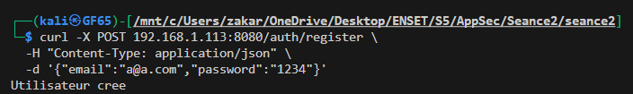
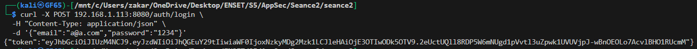
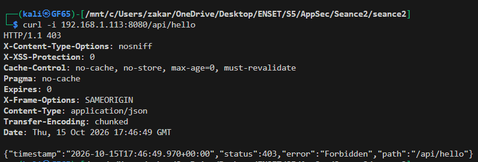
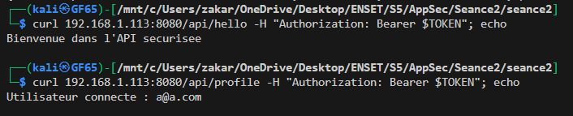

# JWT Demo : Authentification avec Spring Boot & Spring Security

API REST sécurisée par **JWT (JSON Web Token)** avec Spring Boot, Spring Security, JPA et une base H2 en mémoire.

## Fonctionnalités

- Inscription d'un utilisateur (mot de passe haché avec BCrypt)
- Connexion et génération d'un token JWT signé (HMAC-SHA)
- Filtre JWT validant le token à chaque requête
- Routes `/auth/**` publiques, routes `/api/**` protégées
- Sessions stateless

## Technologies

| Technologie | Rôle |
|---|---|
| Java 17+ | Langage |
| Spring Boot 3.x | Framework |
| Spring Security | Authentification / autorisation |
| Spring Data JPA | Accès aux données |
| H2 (in-memory) | Base de données |
| jjwt 0.13.0 | Génération et validation des JWT |
| Maven | Gestion des dépendances |

## Architecture du projet

```
com.test.seance2
├── config
│   └── SecurityConfig
├── controller
│   ├── AuthController
│   └── UserController
├── dto
│   ├── AuthResponse
│   ├── LoginRequest
│   └── RegisterRequest
├── entity
│   └── AppUser
├── repository
│   └── UserRepository
├── security
│   ├── JwtFilter
│   └── JwtService
├── service
│   └── CustomUserDetailsService
└── JwtDemoApplication
```

## Configuration

Fichier `src/main/resources/application.properties` :

```properties
spring.datasource.url=jdbc:h2:mem:securitydb
spring.jpa.hibernate.ddl-auto=update
spring.h2.console.enabled=true
spring.h2.console.path=/h2-console

jwt.secret=<clé en Base64>
jwt.expiration=3600000   # 1 heure en millisecondes
```

Dépendances JWT dans `pom.xml` : `jjwt-api`, `jjwt-impl`, `jjwt-jackson` (0.13.0).

## Fonctionnement

1. `POST /auth/register` : le mot de passe est haché avec BCrypt puis stocké.
2. `POST /auth/login` : `AuthenticationManager` vérifie les identifiants, `JwtService` génère un token signé.
3. Le client envoie le token dans l'en-tête `Authorization: Bearer <token>`.
4. `JwtFilter` vérifie la signature et l'expiration, puis place l'utilisateur dans le `SecurityContext`.
5. Les routes `/api/**` ne sont accessibles qu'aux utilisateurs authentifiés.

| Classe | Rôle |
|---|---|
| `AppUser` | Entité JPA (id, email unique, password, role) |
| `UserRepository` | `findByEmail`, `existsByEmail` |
| `CustomUserDetailsService` | Charge l'utilisateur pour Spring Security |
| `JwtService` | Génère, parse et valide les tokens |
| `JwtFilter` | Filtre exécuté une fois par requête |
| `SecurityConfig` | Règles d'accès, STATELESS, BCrypt |
| `AuthController` | `/auth/register` et `/auth/login` |
| `UserController` | `/api/hello` et `/api/profile` |

## Lancement

```bash
git clone https://github.com/K4YR0/TP2_AppSec.git
cd TP2_AppSec
./mvnw spring-boot:run
```

L'application démarre sur `http://localhost:8080`.

## Tests avec curl

### 1. Inscription

```bash
curl -X POST localhost:8080/auth/register \
  -H "Content-Type: application/json" \
  -d '{"email":"a@a.com","password":"1234"}'
```



### 2. Connexion

```bash
curl -X POST localhost:8080/auth/login \
  -H "Content-Type: application/json" \
  -d '{"email":"a@a.com","password":"1234"}'
```

Le token retourné est ensuite utilisé dans les requêtes protégées.



### 3. Accès sans token (refusé)

```bash
curl -i localhost:8080/api/hello
```



### 4. Accès avec token (autorisé)

```bash
TOKEN=<coller_le_token>
curl localhost:8080/api/hello -H "Authorization: Bearer $TOKEN"
curl localhost:8080/api/profile -H "Authorization: Bearer $TOKEN"
```



## Points de sécurité

- Externaliser le secret JWT (variable d'environnement, vault), ne jamais le commiter.
- Désactiver la console H2 et `show-sql` en production.
- Le `catch` vide dans `JwtFilter` masque les erreurs : ajouter un log et une réponse 401.
- Prévoir refresh token et révocation.
- Valider les entrées (`@Valid`, politique de mot de passe).

## Auteur

**Zakariyae Belagraa** : Cycle Ingénieur Cybersécurité, ENSET Mohammedia